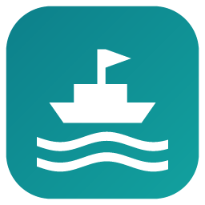
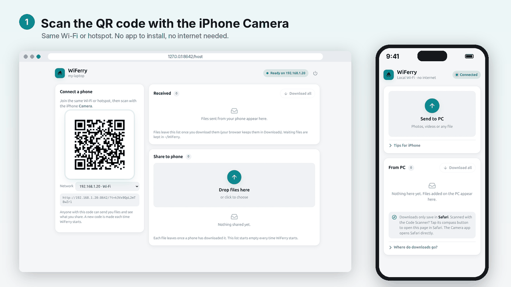
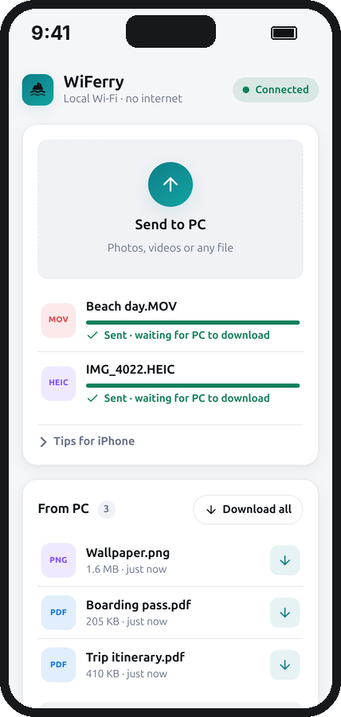
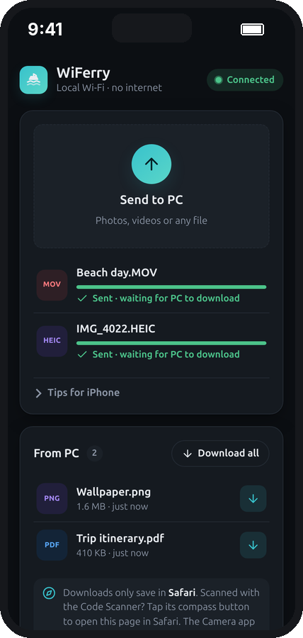
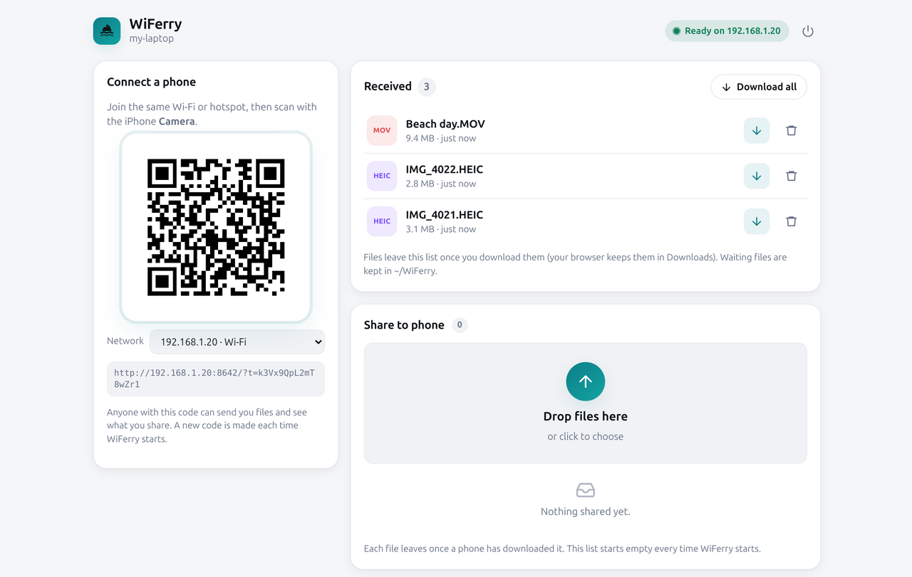

<p align="center">
  
</p>

<h1 align="center">WiFerry</h1>

<p align="center">
  <b>AirDrop-style file transfer between your iPhone and a Windows or Linux PC.</b><br>
  No app on the phone · No internet · One small file on the PC
</p>

<p align="center">
  <a href="https://github.com/pramesh3/wiferry/releases/latest"></a>
  <a href="https://github.com/pramesh3/wiferry/actions/workflows/ci.yml"></a>
  <a href="LICENSE"></a>
  <a href="https://buymeacoffee.com/pramesh3"></a>
</p>

<p align="center">
  
</p>

## Why

Getting photos off an iPhone and onto a Windows or Linux PC is still a pain. You email them to yourself, upload to a cloud and download again, hunt for a cable and drivers, or install an app on both ends.

WiFerry is one file you run on the PC. Scan its QR code with the iPhone camera and you can send files both ways in Safari. Nothing to install on the phone, nothing goes through the internet.

## Features

- **No app on the iPhone.** It's a web page in Safari. Photos, videos and anything in the Files app.
- **Works fully offline.** Home Wi-Fi, a router with no internet, or the iPhone's Personal Hotspot.
- **Both directions.** iPhone → PC and PC → iPhone (and PC ↔ PC, or Android, with any browser).
- **Hand-off, not clutter.** Once the other side has a file, it disappears from both lists.
- **Big files are fine.** Videos stream straight to disk; a 3 GB file uses about 10 MB of memory.
- **Private by default.** A new secret code in the QR each launch; phones can't browse your PC.
- **One small file.** ~8 MB, no installer, no runtime. Click *Add shortcut* to put it on your desktop.
- **Light and dark mode**, made for small screens.

<p align="center">
  
  &nbsp;&nbsp;
  
</p>

## Quick start

1. **Download** the file for your PC from [Releases](https://github.com/pramesh3/wiferry/releases/latest):
   - Windows: `wiferry-windows-amd64.exe`
   - Linux: `wiferry-linux-amd64` (or `-arm64` for ARM, like a Raspberry Pi)
2. **Start it.**
   - **Windows:** double-click the `.exe`. If Windows Firewall asks, allow it on **Private networks**.
     WiFerry is new and not code-signed yet, so Windows is cautious the first time:
     - Edge may say the file *isn't commonly downloaded*: in Downloads, click the **⌄** next to *Delete* → **Keep anyway**.
     - If a blue *Windows protected your PC* box appears, click **More info → Run anyway**.
   - **Linux:** right-click the file → Properties → allow running as a program, then double-click it.
     Or: `chmod +x wiferry-linux-amd64 && ./wiferry-linux-amd64`
3. The WiFerry page opens in your browser. Click **Add shortcut** to put WiFerry on your desktop and in your app menu / Start Menu. Next time, just click the icon.
4. Put the iPhone on the **same Wi-Fi** as the PC (or connect the PC to the iPhone's Personal Hotspot).
5. Scan the QR code with the iPhone **Camera** app and tap the link. It opens Safari.
6. **Send to PC:** tap *Send to PC* and pick from Photo Library, Take Photo or Choose File.
   **Send to phone:** drop files on the PC page under *Share to phone*, then tap them on the iPhone.

To quit, click the **power button** at the top right of the PC page.

<p align="center">
  
</p>

## How it compares

| | WiFerry | [LocalSend](https://localsend.org) | [PairDrop](https://pairdrop.net) / Snapdrop | [KDE Connect](https://kdeconnect.kde.org) |
|---|---|---|---|---|
| App needed on the iPhone | **No** (Safari) | Yes | **No** (browser) | Yes |
| Works with no internet at all | **Yes** | **Yes** | Only if you self-host the server | **Yes** |
| PC side | One file, no install | App | Browser + public or self-hosted server | App |
| Finding devices | Scan a QR code | Automatic | Automatic | Automatic |

All of these are good open-source projects. If you're happy installing an app on every device and want automatic discovery, LocalSend is excellent. WiFerry is for when you want **nothing on the phone and nothing on the internet**.

## FAQ

**Does it need internet?**
No. The PC and phone only need to be on the same network. A router with no internet works, and so does the iPhone's Personal Hotspot with mobile data turned off.

**Is it safe?**
Each launch creates a new random code inside the QR. Without it, other devices on the Wi-Fi only see "Not connected". Phones can only send files and download what you chose to share; they can't browse your PC or see what others sent. Traffic is plain HTTP on your local network, so use it on networks you trust (home, your own hotspot) rather than public Wi-Fi.

**Why not just use AirDrop?**
AirDrop only works between Apple devices. WiFerry is for iPhone ↔ Windows and iPhone ↔ Linux.

**Does it work with Android?**
Yes. The phone side is a normal web page, so any modern browser works. iPhone is what we test most.

**Where do files go?**
On the PC, files from the phone are listed on the page; downloading one saves it to your browser's Downloads. Files waiting to be picked up are kept in `~/WiFerry/Received`. On the iPhone, downloads go to Files → Downloads.

**Mac?**
Not released yet. It builds on macOS from source; testers are welcome.

## iPhone tips

- **Use the Camera app to scan.** The Control Center *Code Scanner* opens a mini viewer that can't save downloads; tap its compass button to move to Safari.
- **Keep originals (HEIC):** Photo Library may convert photos to JPEG. To keep originals, save them to Files first (Photos → Share → Save to Files), then send with *Choose File*.
- **"Optimize iPhone Storage":** photos stored only in iCloud can't be sent offline. Open them in Photos while online first.
- **Keep the screen on** while sending; Safari pauses uploads when locked. Failed files show a **Retry** button.
- **Keep downloads on the phone, not iCloud:** Settings → Apps → Safari → Downloads → *On My iPhone*.
- **Download all** saves a dated zip (`WiFerry-2026-11-17_15-42.zip`). Tap it once in Files to get a folder.
- **Saving to Photos:** open the image in Files and tap Share → Save Image.

## Details

<details>
<summary><b>How files are handled</b></summary>

- Files work as a hand-off in both directions: once the other side has fully downloaded a file, it disappears from the list. Partial or failed downloads keep it.
- On the PC, downloading a received file saves it to your browser's Downloads and removes it from `~/WiFerry/Received`.
- Every start is a fresh session: the shared list starts empty, and the PC page shows only files received in this session. Received files you never downloaded stay in the folder.
- Files you share from the PC are copies; your originals are never touched.
</details>

<details>
<summary><b>Launching, shortcuts and uninstalling</b></summary>

- Clicking the WiFerry icon while it's already running just reopens the page.
- From a terminal: `wiferry --install` / `wiferry --uninstall`. Uninstalling keeps your files in `~/WiFerry`.

Installed for the current user only, no admin rights needed:

| | Linux | Windows |
|---|---|---|
| App | `~/.local/bin/wiferry` | `%LOCALAPPDATA%\Programs\WiFerry\WiFerry.exe` |
| Menu | `~/.local/share/applications/wiferry.desktop` | Start Menu → WiFerry |
| Desktop | `~/Desktop/wiferry.desktop` | Desktop → WiFerry |
</details>

<details>
<summary><b>Options and firewall</b></summary>

```
wiferry [--port 8642] [--dir ~/WiFerry] [--no-browser] [--install | --uninstall]
```

If port 8642 is busy and `--port` wasn't given, a free port is chosen.

- **Windows:** allow WiFerry on Private networks when prompted. If you missed it: Windows Security → Firewall → Allow an app.
- **Linux (ufw):** `sudo ufw allow 8642/tcp`
</details>

## Build from source

Needs Go 1.22+.

```
go install github.com/pramesh3/wiferry/cmd/wiferry@latest
```

Or from a clone:

```
make test        # vet + unit/integration tests
make check       # + end-to-end and headless-Chrome UI tests
make build-all   # linux-amd64, linux-arm64, windows-amd64 in dist/
```

## Contributing

Issues and pull requests are welcome. See [CONTRIBUTING.md](CONTRIBUTING.md), the [roadmap](ROADMAP.md) and the [changelog](CHANGELOG.md).

- **No code needed:** try WiFerry on your devices and file a [device test report](https://github.com/pramesh3/wiferry/issues/new?template=device_report.yml). Real iPhones, iOS versions, Windows PCs and Android phones are especially helpful.
- **New to the code?** Start with a [`good first issue`](https://github.com/pramesh3/wiferry/labels/good%20first%20issue).

## Support

WiFerry is free and open source, built in my spare time. If it saved you a cable hunt or a cloud upload, you can:

- ⭐ **Star the repo** so other people can find it
- 🐛 **Report bugs** or share what device you tested on
- ☕ **[Buy me a coffee](https://buymeacoffee.com/pramesh3)** to support development

<p>
  <a href="https://buymeacoffee.com/pramesh3"></a>
</p>

## License

MIT. See [LICENSE](LICENSE).

iPhone, iOS, AirDrop and Safari are trademarks of Apple Inc. WiFerry is not affiliated with or endorsed by Apple.
